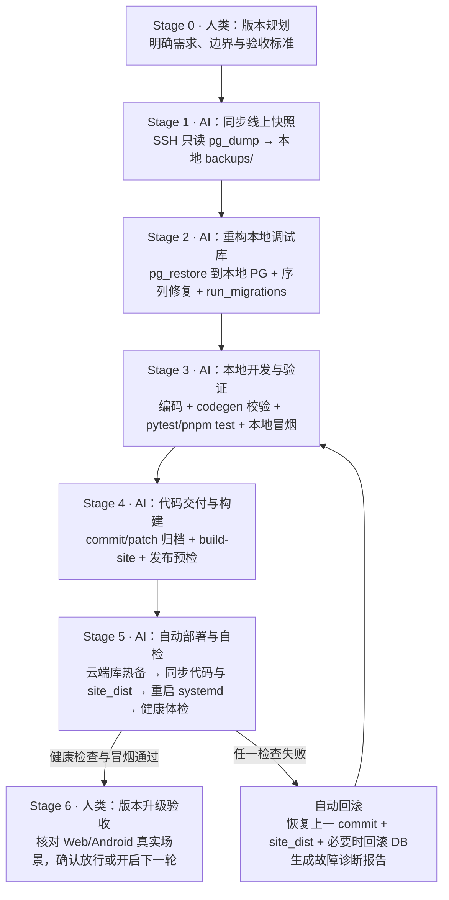

# SailZen 双环境架构与 AI 自动化运维手册

> **版本**: v1.1 | **更新**: 2026-11-22 | **状态**: ✅ Phase 0 工具链已落地（待填写本机 `.env.ops` 并实跑验收）
> **关联文档**: [AGENTS.md](../../AGENTS.md) · [ROADMAP.md](../ROADMAP.md) · [ENV.md](../ENV.md) · [DeployPostgres.md](./DeployPostgres.md) · [SailTickAcceptance.md](./SailTickAcceptance.md)

---

## 1. 目标与分工原则

SailZen 已演进为多端协作的个人系统（云端后端 + PostgreSQL + Web 前端 + Android App + VSCode 笔记插件 + SailTick Daemon）。过去“手动备份云端数据 → 手动构建本机调试库 → 手动 SSH 上云部署”的运维方式严重拖慢了功能迭代速度。

本手册的核心目标是将运维能力标准化、脚本化、可被 AI 安全调用，建立清晰的**人机分工**：

- **人（决策与验收）**：负责版本功能规划、敏感凭据初次配置、以及上线后的最终版本升级验收。
- **AI（开发与自动运维）**：在明确隔离边界下，自主完成「云端只读快照拉取 → 本地调试库重构 → 新功能编码与自动化验证 → 预检备份 → SSH 自动化部署上线 → 线上健康检查与异常回滚」。

---

## 2. 双环境拓扑与边界对照

```text
┌────────────────────────────────────────────────────────────────────────────┐
│  环境 A：Windows 本地开发调试机（当前工作站）                                 │
│                                                                            │
│  · OS / Shell : Windows + pwsh (PowerShell 7)                              │
│  · 工具链     : uv (Python>=3.13), Node/pnpm, 本地 PostgreSQL,             │
│                 Android Studio / JDK 17 / adb, OpenSSH (ssh/scp), git      │
│  · 配置文件   : .env.dev (本地开发) / .env.debug (深度调试)                 │
│  · 数据库     : 本地调试 PostgreSQL (如 sailzen_dev) 或 SQLite (轻量开发)    │
│  · 服务进程   : uv run server.py --dev  +  pnpm run dev:site               │
│  · 数据来源   : 只读拉取云端备份快照 → 本地重构，严禁直接写云端库             │
└────────────────────────────────────┬───────────────────────────────────────┘
                                     │
         (1) 只读拉取备份快照 (SSH/pg_dump)  │  (2) 发布同步/部署 (SSH + systemd)
                                     ▼
┌────────────────────────────────────────────────────────────────────────────┐
│  环境 B：公网 Linux 云服务器（生产部署环境）                                  │
│                                                                            │
│  · OS / 托管  : Ubuntu Linux + systemd                                     │
│  · 配置文件   : .env.prod (服务器本机私有，严禁入库)                         │
│  · 数据库     : 云端 PostgreSQL 17 (唯一权威事实源，定期本地+异地快照)       │
│  · 常驻服务   : 1) sailzen-server.service (sail_server + 静态 site_dist)    │
│                 2) sailtick.service (SailTick 教练 daemon, 127.0.0.1:9070) │
│  · 外部触点   : 公网 IP/域名访问 Web UI；手机 Android App 连接 REST + WS    │
└────────────────────────────────────────────────────────────────────────────┘
```

### 环境差异速查表

| 配置项 | 本地调试环境（`.env.dev`） | 云端生产环境（`.env.prod`） |
|---|---|---|
| `ENV`（由 `server.py` 参数自动设置） | `dev`（`--dev`）或 `debug`（`--debug`） | `prod`（默认无参数） |
| `DB_BACKEND` | `postgres`（本地调试库）或 `sqlite`（零配置） | `postgres`（强制） |
| `POSTGRE_URI` | 指向 `localhost:5432/sailzen_dev`（或本地库） | 指向云端本机 `localhost:5432/main` |
| `SERVER_PORT` | 调试端口（如 `4399` 或 `1974`） | 生产端口（如 `1974`） |
| `LOG_MODE` / `LOG_LEVEL` | `dev` / `DEBUG` | `prod` / `INFO` |
| `DB_DEBUG` / `API_DEBUG` | `true` | `false` |
| `SITE_DIST` | 开发期走 Vite (`pnpm run dev:site`)，集成验证走 `site/dist` | 构建产物目录（与 `server.py` 的 `SITE_DIST` 对齐） |
| `SAILZEN_API_TOKEN` | 可选（测试鉴权时开启） | **强制开启**（保护公网 API 与 Android/SailTick 通信） |
| `WEATHER_ENABLED` / `REMINDER_ENABLED` | 按需开关（避免调试期向真机狂推提醒） | `true` |

> **关键防呆建议**：在本地 `.env.dev` 中，调试提醒或 SailTick 时应避免配置生产真机的推送目标，或将 `REMINDER_ENABLED=false` / 使用 SailTick `shadow` 模式，防止本地调试数据触发真实手机通知。

---

## 3. 当前运维短板审计（2026-11-22 现状）

在对仓库和本机环境盘点后，确认以下 **6 项关键短板**需要优先补齐，否则 AI 无法顺畅接管自动运维：

| # | 短板 | 现状事实 | 影响 | 补齐方向 |
|---|---|---|---|---|
| 1 | **本地 PG CLI 未入 PATH** | 本机已装 PostgreSQL，但 `psql` / `pg_dump` / `pg_restore` 当前不在系统 `PATH` 中 | AI 无法直接执行标准 dump/restore 还原本地调试库 | 将 PostgreSQL `bin` 加入 PATH，或在本地运维配置中声明 `PG_BIN_DIR` |
| 2 | **`db_sync.py` 表覆盖不全且耦合 ORM** | `scripts/db_sync.py` 仅导入了 6 个 ORM 模块，遗漏了 `reminder`、`rhythm`、`tick`；且逐行 ORM 复制不如原生 `pg_dump` 完整（丢触发器/索引/序列） | 从线上拉数据构建本地调试库时数据不完整，且容易引发主键序列冲突 | 线上备份与本地重构**全面改用原生 `pg_dump -Fc` + `pg_restore`**；同时补齐 `db_sync.py` 缺失模块用于轻量 SQLite 导出 |
| 3 | **云端 systemd 服务名与路径不统一** | `doc/maintain/DeployPostgres.md` 使用 `my-server.service` + `/home/ubuntu/repos/SailZen`；`scripts/sailtick.service` 依赖 `sailzen-server.service` + `/home/%I/SailZen` | AI 无法确定云端重启哪个 service、代码放哪个目录 | 在仓库中提供标准 `scripts/sailzen-server.service` 模板，并通过本机 `.env.ops`（gitignore）声明云端真实路径与服务名 |
| 4 | **缺少免交互 SSH 别名与运维配置文件** | 本机尚未配置 `~/.ssh/config` 别名（如 `Host sailzen-prod`），也缺少无密钥/非明文密码的运维参数模板 | AI 每次 SSH/SCP 都要询问 IP、用户名、路径，无法自动化执行 | 配置 SSH 密钥登录 + `~/.ssh/config` 别名 `sailzen-prod`；仓库提供 `.env.ops.template` |
| 5 | **Web 前端构建与部署链路断裂** | `site/vite.config.ts` 输出到 `site/dist`，而 `server.py` 默认静态目录是 `SITE_DIST=site_dist`，两者衔接目前纯靠手工复制 | 改完前端容易漏发静态资源或版本错位 | 在自动部署脚本中统一执行 `pnpm run build-site` → 原子替换云端 `SITE_DIST` 目录 |
| 6 | **缺少发布前门禁与上线后回滚脚本** | 部署后没有自动化 `/api/v1/health` + 核心读接口校验，也没有一键回滚到上一 commit / 上一备份的脚本 | 线上出错需要人工 SSH 排障，风险高 | 构建 `scripts/ops/deploy_cloud.py`：发布前自动备份 DB + 记录 `PREV_COMMIT` → 发布 → 体检失败自动回滚 |

---

## 4. AI 主导的迭代开发与自动运维闭环

目标开发循环分为 6 个阶段，**只有 Stage 0（规划）与 Stage 6（最终验收）需要人工介入**，Stage 1–5 全部由 AI 在护栏内自动推进：



### 各阶段输入、动作与退出门禁

| 阶段 | 执行者 | 核心动作 | 退出门禁（硬条件） |
|---|---|---|---|
| **Stage 0** | 人类 | 提出本轮迭代目标（如新功能/修 Bug/升级某个模块） | 明确目标端（Backend / Site / Android / SailTick）与验收点 |
| **Stage 1** | AI | 执行 `backup_prod_db.py`：通过 SSH 在云端执行只读 `pg_dump -Fc` 并拉回本地 `data/backups/` | 备份文件非空且 `pg_restore --list` 校验可读 |
| **Stage 2** | AI | 执行 `restore_local_db.py`：清空并重建本地调试库（**严格校验目标 Host 必须为 localhost/127.0.0.1**），修复主键序列，执行 `run_migrations()` | 本地 `server.py --dev` 启动无报错，`/api/v1/health` 返回 `200` |
| **Stage 3** | AI | 开发功能；修改 `body_metrics.toml` 则跑 codegen；运行 `uv run pytest`、`pnpm test`、`sailtick_smoke.py` 及本地接口/页面冒烟 | 所有单测、类型检查（`tsc --noEmit`）、契约检查全绿 |
| **Stage 4** | AI | 清理临时文件，按 `commit-current-change` 提交（若受 `$ALLOW_PUSH` 限制则按 `finalize-today-work` 出 patch），构建前端产物 `pnpm run build-site` | 工作区干净，前端构建产物最新，迁移 SQL 幂等自检通过 |
| **Stage 5** | AI | 执行 `deploy_cloud.py`：① 云端部署前强制备份 DB；② 记录云端当前 `git rev-parse HEAD`；③ 更新云端代码与 `site_dist`；④ `uv sync`；⑤ 重启 `sailzen-server`（及按需重启 `sailtick`）；⑥ 跑只读线上健康体检 | `/api/v1/health` + 关键业务 GET 接口均 `200` + `journalctl` 无启动异常；失败自动回滚 |
| **Stage 6** | 人类 | 打开公网 Web / 手机 Android App（如有客户端更新则安装新 APK）按 AI 生成的验收清单核对 | 人工确认验收通过，更新迭代记录 |

---

## 5. 自动化运维工具链（已落地，位于 `scripts/ops/`）

上述闭环已全部脚本化落地，所有脚本遵循**凭据收敛**原则：**数据库密码与 `SAILZEN_API_TOKEN` 直接复用 `.env.prod` / `.env.dev`**，SSH 与云端部署参数收敛在 `.env.ops`（也支持追加到 `.env.prod` 兜底读取）。

### 5.1 运维配置初始化

从仓库根模板复制出本机私有配置（`.env.ops` 已加入 `.gitignore`，**绝不提交**）：

```powershell
Copy-Item .env.ops.template .env.ops
```

关键特性：
- **零重复填密码**：`backup_prod_db.py`、`restore_local_db.py`、`health_check.py` 直接读取 `.env.prod` 与 `.env.dev` 中的 `POSTGRE_URI` 和 `SAILZEN_API_TOKEN`。
- **PG / pgAdmin4 自动探测**：`OPS_PG_BIN_DIR` 留空时自动扫描 `PATH` → `C:\Program Files\PostgreSQL\<最高版本>\bin` → `pgAdmin 4\runtime` 中的 `pg_dump` / `pg_restore` / `psql`。
- **双备份模式**：默认 `OPS_BACKUP_MODE=direct`（本机只读直连 `.env.prod` 的生产 PG，配合 pgAdmin4/PG 客户端开箱即用）；若云端 5432 仅监听内网，切为 `OPS_BACKUP_MODE=ssh` 即可在云端导出后经 `scp` 拉回。

### 5.2 五个核心运维脚本（`scripts/ops/`）

1. **`scripts/ops/doctor.py`** — 双环境诊断：检查 `.env.ops` / `.env.dev` / `.env.prod`、自动探测 PG/pgAdmin4 工具版本、校验本地调试库安全边界；加 `--check-remote` 可只读实测生产 PG 与 SSH 连通性。
2. **`scripts/ops/backup_prod_db.py`** — 生产库只读备份：支持 `--mode direct|ssh`、`--dry-run`，生成 `data/backups/prod_<db>_YYYYMMDD_HHMMSS.dump`，自动执行 `pg_restore --list` 完整性校验、更新 `LATEST_PROD_DUMP.txt` 并按保留天数滚动清理（至少保留最新 3 份）。
3. **`scripts/ops/restore_local_db.py`** — 本地调试库一键重构：**硬护栏强制校验目标 Host 必须为 `localhost` / `127.0.0.1` / `::1`**；自动断开本地残留连接、重建库、`pg_restore --no-owner --no-acl` 导入快照、执行 `public` 全表自增序列修复，并运行 `sail_server` 幂等迁移自检。
4. **`scripts/ops/health_check.py`** — 只读健康体检：校验 `GET /api/v1/health` 与全部 10+ 核心业务只读 GET 路由（Finance / Health / Rhythm / Reminder / Tick / Life / Necessity / Text）及 Web 首页，支持 `--env dev|prod`、`--with-sailtick`（校验 `:9070/health`）与重启重试。
5. **`scripts/ops/deploy_cloud.py`** — 云端自动化部署与回滚：支持 `--dry-run`、`--backend-only`、`--site-only`、`--with-sailtick`、`--sync-mode git|patch`、`--rollback <commit>`；自动完成「本地回归门禁 → 部署前强制生产库备份 → 记录 `PREV_COMMIT` → 构建并原子替换 `site_dist`（保留 `.prev`）→ 同步代码与 `uv sync` → 重启 systemd → 线上体检（失败自动回滚并拉取 `journalctl`）」。

### 5.3 配套部署模板与 AI Skill

- **统一 systemd unit**：已提供 [scripts/sailzen-server.service](../../scripts/sailzen-server.service)（与 `scripts/sailtick.service` 的 `After=sailzen-server.service` 完全一致）。
- **AI Ops Skill**：已提供 [`.agents/skills/sailzen-ops/SKILL.md`](../../.agents/skills/sailzen-ops/SKILL.md)，供任意新会话 AI 按安全门禁直接调用。
- **Android 产物分发（Phase 1 扩展）**：后续补充 `scripts/ops/build_android_release.py`，校验签名配置后打包并输出 SHA256 与私有下载链接。

---

## 6. 安全红线与应急回滚清单

### 硬性安全护栏

1. **只读优先**：拉取线上数据永远走 `pg_dump` 只读导出，禁止任何开发脚本向生产库写入测试数据。
2. **先备份再发布**：任何涉及 `sailzen-orm` 表结构变更或 `sail_server/migration/*.sql` 的发布，必须先拿到可验证的云端 DB 备份文件，再重启服务。
3. **禁止破坏性 DDL**：云端 SQL 迁移坚持 **Expand-and-Contract（只增不删）** 策略——新增列必须带默认值或可空，禁止直接 `DROP COLUMN` / `DROP TABLE`，确保代码回滚时旧版本仍可兼容当前 Schema。
4. **敏感信息零入库**：`.env.*`、`.env.ops`、`data/backups/`、`android/keystore/` 必须全部在 `.gitignore` 中排除。
5. **SailTick 灰度保护**：涉及 `sailtick/` 的上线优先以 `canary` 或 `shadow` 模式观察至少 1–2 个 Tick，再切换 `live`（见 [sailtick-testing.md](../design/agent-system/sailtick-testing.md)）。

### 应急回滚命令（云端手动兜底）

```bash
# 1. 回滚代码到部署前 commit
cd $OPS_REMOTE_REPO
git checkout <PREV_COMMIT>
uv sync

# 2. 重启核心服务
sudo systemctl restart sailzen-server.service
sudo systemctl status sailzen-server.service --no-pager

# 3. 如有必要，暂停 SailTick（或通过 :9070/canary 切为 off）
sudo systemctl stop sailtick.service

# 4. 查看实时日志定位问题
sudo journalctl -u sailzen-server.service -n 100 --no-pager
```


## ssh环境配置

为了避免每一次都输入密码，可以考虑生成专用私钥

ssh-keygen -t ed25519 -f "$env:USERPROFILE\.ssh\id_ed25519_sailzen" -N '""' -C "sailzen-ops"
$pubKey = Get-Content "$env:USERPROFILE\.ssh\id_ed25519_sailzen.pub" -Raw
$pubKey | ssh <云端用户名>@<云端IP> "mkdir -p ~/.ssh && chmod 700 ~/.ssh && cat >> ~/.ssh/authorized_keys && chmod 600 ~/.ssh/authorized_keys"

$pubKey | ssh ubuntu@101.43.22.254 "mkdir -p ~/.ssh && chmod 700 ~/.ssh && cat >> ~/.ssh/authorized_keys && chmod 600 ~/.ssh/authorized_keys"

C:\Users\zhuzihang\.ssh\config

Host sailzen-prod
    HostName <云端IP>
    User <云端用户名>
    Port 22
    IdentityFile ~/.ssh/id_ed25519_sailzen
    IdentitiesOnly yes
    ServerAliveInterval 60


Host sailzen-prod
    HostName 101.43.22.254
    User ubuntu
    Port 22
    IdentityFile ~/.ssh/id_ed25519_sailzen
    IdentitiesOnly yes
    ServerAliveInterval 60